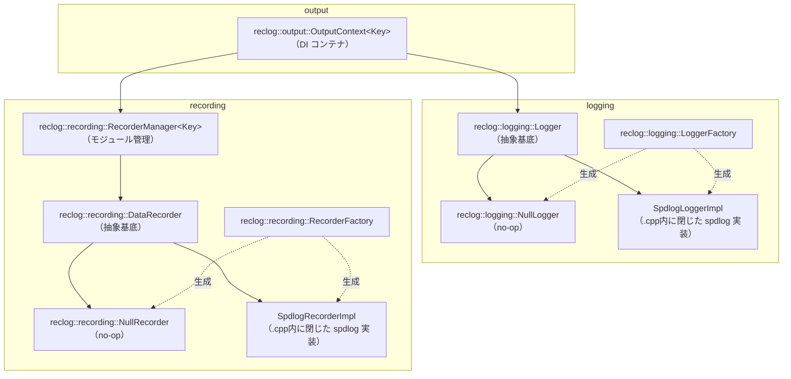

# 出力システム設計ドキュメント

## 概要

科学技術計算シミュレータにおいて、**診断ログ**と**解析データ**を分離しつつ統一的に管理する出力システム。

設計上の目標：

- DI（依存性注入）によりアプリケーションコアを出力実装から分離する
- モジュール単位でデータ出力の有効・無効を切り替える
- 出力先（ファイル・コンソール等）を柔軟に構成できる
- spdlog 等の実装詳細を公開ヘッダーから隠蔽し、ABI・ビルド時間への影響を抑える
- 将来的な並列実行（OpenMP / MPI）対応を考慮する

---

## 全体アーキテクチャ

```text
Application Core
      │
      ▼
reclog::output::OutputContext<Module>（DI）
 ├── reclog::logging::Logger（診断ログ）
 └── reclog::recording::RecorderManager<Module>
        ├── Module::kSolver     → reclog::recording::DataRecorder
        ├── Module::kMesh       → reclog::recording::DataRecorder
        └── Module::kDebugProbe → reclog::recording::DataRecorder
```

- 診断ログと解析データは完全に分離する
- 解析データはモジュール単位で独立した DataRecorder を持つ

---

## ファイル構成

- `include/reclog/`
    - `logging/`
        - `log_level.hpp` — `LogLevel` 定義（spdlog 非依存）
        - `logger.hpp` — `Logger` 抽象基底クラス（spdlog 非依存、fmt のみ依存）
        - `null_logger.hpp` — 何もしない実装
        - `logger_factory.hpp` — Logger インスタンス生成ファクトリ（宣言のみ）
    - `recording/`
        - `data_recorder.hpp` — `DataRecorder` 抽象基底クラス・`Write()` ヘルパー
        - `null_recorder.hpp` — 何もしない実装
        - `recorder_manager.hpp` — モジュール別管理（header-only）
        - `recorder_factory.hpp` — DataRecorder インスタンス生成ファクトリ（宣言のみ）
    - `output/`
        - `output_context.hpp` — `Logger` + `RecorderManager` の DI コンテナ（header-only）
- `src/`
    - `logging/logger_factory.cpp` — spdlog を使った Logger 実装（この翻訳単位に閉じる）
    - `recording/recorder_factory.cpp` — spdlog を使った DataRecorder 実装（この翻訳単位に閉じる）

テスト用:

- `tests/support/spy_logger.hpp` — メモリ蓄積によるテスト検証用 Logger 実装
- `tests/support/spy_recorder.hpp` — メモリ蓄積によるテスト検証用 DataRecorder 実装

---

## 責務分離

### reclog::logging::Logger（診断ログ）

- デバッグ・進行状況・エラー報告を担う
- ログレベル制御（trace / debug / info / warn / error / critical）
- 非同期対応可能
- 人間向けの可読テキストを出力する

### reclog::recording::DataRecorder（解析データ）

- 科学データをモジュール別に記録する
- Enable / Disable による出力制御（レベル概念なし）
- 出力フォーマットは raw（CSV 等、タイムスタンプ等のメタデータなし）

---

## spdlog 隠蔽方針

`Logger` / `DataRecorder` は純粋仮想インターフェースのみを公開ヘッダーに置き、
spdlog への依存は `src/logging/logger_factory.cpp` / `src/recording/recorder_factory.cpp` の
翻訳単位に閉じ込める。実装クラス（`SpdlogLoggerImpl` / `SpdlogRecorderImpl`）は
これらの `.cpp` 内の無名 namespace で定義され、公開ヘッダーからは一切参照できない。

利点:

- 利用側が spdlog のバージョンやヘッダーを意識しなくてよい
- `reclog_logging` / `reclog_recording` を静的/共有ライブラリとして事前ビルドでき、
  利用側の再コンパイルコストを抑えられる
- spdlog の ABI 変更が公開インターフェースに波及しない

トレードオフ:

- `LoggerFactory` / `RecorderFactory` が返すインスタンスの生成は必ずファクトリ経由になる
  （テストでは `NullLogger` / `NullRecorder` を直接生成すればよい）

---

## インターフェース定義

### reclog::logging::Logger

```cpp
// include/reclog/logging/logger.hpp

namespace reclog::logging {

enum class LogLevel : std::uint8_t { kTrace = 0, kDebug, kInfo, kWarn, kError, kCritical, kOff };

class Logger {
public:
    virtual ~Logger() = default;

    virtual void Log(LogLevel level, std::string_view msg) = 0;
    virtual void SetLevel(LogLevel level) = 0;
    virtual LogLevel Level() const = 0;

    // 非仮想ヘルパー: コスト高い文字列生成をレベル確認後に行うために使う
    bool ShouldLog(LogLevel lvl) const { return lvl >= Level(); }

    // 非仮想テンプレートヘルパー: fmt でフォーマットしてから Log(level, string_view) に委譲する
    template <typename... Args>
    void Log(LogLevel level, fmt::format_string<Args...> fmt_str, Args&&... args);
};

} // namespace reclog::logging
```

`Log()` の仮想オーバーロードとテンプレートオーバーロードは C++ の名前解決上、
派生クラスで `Log(LogLevel, string_view)` を `override` すると同名のテンプレートが
隠蔽される。派生クラス（`NullLogger` / `SpyLogger` / `SpdlogLoggerImpl` 等）では
`using Logger::Log;` を明示することでテンプレートオーバーロードを可視化している。

### reclog::recording::DataRecorder

```cpp
// include/reclog/recording/data_recorder.hpp

namespace reclog::recording {

class DataRecorder {
public:
    virtual ~DataRecorder() = default;

    virtual void Enable() = 0;
    virtual void Disable() = 0;
    virtual bool IsEnabled() const = 0;

    virtual void Output(std::string_view msg) = 0;
    virtual void Flush() = 0;

    // 非仮想ヘルパー: fmt でフォーマットしてから Output() に渡す
    template <typename... Args>
    void Write(fmt::format_string<Args...> fmt_str, Args&&... args);
};

} // namespace reclog::recording
```

#### Write() の設計方針

`Output(string_view)` は文字列を受け取るだけなのでラッパー経由では fmt のフォーマット機能が失われる。
これを解決するため、非仮想テンプレートの `Write()` を提供する。

```cpp
recorder.Write("{},{:.6f}", step, value);
```

- フォーマット文字列は `fmt::format_string` によりコンパイル時にチェックされる
- `IsEnabled()` が false の場合は `fmt::format` 自体をスキップする（フォーマットコスト不要）
- 仮想関数は `Output(string_view)` のみなので、テスト・モックが容易

---

## クラス構成



---

## 各クラスの詳細

### reclog::logging::Logger 実装クラス

| クラス                        | 所在                                       | 用途                      |
| ----------------------------- | ------------------------------------------ | ------------------------- |
| `reclog::logging::NullLogger` | `include/reclog/logging/null_logger.hpp`   | 何もしない、DI デフォルト |
| `SpdlogLoggerImpl`            | `src/logging/logger_factory.cpp`（非公開） | spdlog 同期・非同期       |
| `SpyLogger`（tests/）         | `tests/support/spy_logger.hpp`             | メモリ蓄積、テスト検証用  |

`NullLogger` は「ログを一切出したくない」実行パス（ベンチマーク実行時など）や、`Logger&`
を要求する API に渡す DI デフォルト値として使う。`SpyLogger` は Logger を利用するコード
（`OutputContext` 経由のアプリケーションコア等）が「期待したレベル・内容でログを呼んだか」を
検証するために使う。`ShouldLog()` の使い道・使用例は [ShouldLog() の使い道](#shouldlog-の使い道)、
`SpyLogger` の使用例は [SpyLogger の使い方](#spylogger-の使い方) を参照。

### reclog::recording::DataRecorder 実装クラス

| クラス                            | 所在                                           | 用途                                 |
| --------------------------------- | ---------------------------------------------- | ------------------------------------ |
| `reclog::recording::NullRecorder` | `include/reclog/recording/null_recorder.hpp`   | 何もしない、DI デフォルト            |
| `SpdlogRecorderImpl`              | `src/recording/recorder_factory.cpp`（非公開） | spdlog ファイル出力（`%v` パターン） |
| `SpyRecorder`（tests/）           | `tests/support/spy_recorder.hpp`               | メモリ蓄積、テスト検証用             |

`SpdlogRecorderImpl` はコンストラクタ時に `set_pattern("%v")` を設定し、メッセージのみを出力する
（タイムスタンプ等を付加しない）。初期状態は disabled。

`NullRecorder` は「このモジュールの解析データ出力を無効化したい」場合の DI デフォルト値として使う
（`RecorderManager` は未登録キーへのアクセスで例外を送出するため、「出力しないモジュール」も
明示的に登録しておく必要がある。詳細は [「モジュール別レコーダー」の例](#モジュール別レコーダーの例) を参照）。
`SpyRecorder` は `Write()` / `Output()` で渡された内容と `Flush()` の呼び出し回数をメモリに蓄積し、
テストコードから検証するために使う。使用例は [SpyRecorder の使い方](#spyrecorder-の使い方) を参照。

### reclog::recording::RecorderManager\<Key\>

enum class をキーにして複数の DataRecorder を管理する。`unique_ptr` で所有する。

```cpp
template <typename Key>
class reclog::recording::RecorderManager {
public:
    void RegisterRecorder(Key key, std::unique_ptr<DataRecorder> recorder);
    DataRecorder& operator[](Key key);            // 未登録は out_of_range
    const DataRecorder& operator[](Key key) const;
    void FlushAll();
};
```

### reclog::output::OutputContext\<Key\>

Logger と RecorderManager を一つにまとめ、アプリケーションコアへ DI で注入する。

```cpp
template <typename Key>
class reclog::output::OutputContext {
public:
    OutputContext(logging::Logger& logger, recording::RecorderManager<Key>& recorders);
    logging::Logger& GetLogger();
    recording::RecorderManager<Key>& GetRecorders();
};
```

---

## ターゲット構成

`reclog` は 3 つの CMake ターゲットに分割されている。

| ターゲット          | 種別           | 内容                                                            |
| ------------------- | -------------- | --------------------------------------------------------------- |
| `reclog::logging`   | 通常ライブラリ | `Logger` インターフェース + spdlog 実装（`.cpp` に閉じる）      |
| `reclog::recording` | 通常ライブラリ | `DataRecorder` インターフェース + spdlog 実装（同上）           |
| `reclog::output`    | INTERFACE      | `OutputContext<Key>`（header-only）。logging/recording を束ねる |

fmt は `Write()` / `Log()` テンプレートヘルパーが公開ヘッダーで型を使うため PUBLIC 依存、
spdlog は実装（`.cpp`）にのみ現れるため PRIVATE 依存とする。

---

## install / find_package(reclog CONFIG) 対応

`-DRECLOG_INSTALL=ON` を指定した場合のみ `install(EXPORT)` を評価する（デフォルト OFF）。
FetchContent/add_subdirectory 経由の利用ではこのブロックは評価されないため影響を受けない。

`reclog_logging` / `reclog_recording` の PRIVATE 依存である spdlog（静的ライブラリ）は、
CMake の仕様上 `install(EXPORT)` の export セットに含まれていないとエラーになる
（静的リンクの推移依存はリンク時に解決される必要があるため）。この問題は依存の取得経路で
対応が異なる。

- **FetchContent で新規取得した場合**: `cmake/dependencies-lib.cmake` が
  `RECLOG_FMT_FETCHED` / `RECLOG_SPDLOG_FETCHED` を `ON` に設定する。この場合、
  トップレベル `CMakeLists.txt` の install ブロックで `fmt` / `spdlog` 自体も
  `reclogTargets` の export セットに含める（`reclog::spdlog` 等の名前で同梱される）。
  `reclogConfig.cmake.in` 側もこのフラグを見て `find_dependency(fmt/spdlog)` を
  スキップする（同梱物と二重に解決させない）。
- **find_package で既存の物を見つけた場合**: 利用側の環境に既にインストールされているため
  export セットに含めず、`reclogConfig.cmake.in` の `find_dependency()` で再解決する。

spdlog は内部で `Threads::Threads` にリンクしているため、FetchContent 経由の場合は
`reclogConfig.cmake.in` で `find_dependency(Threads)` も解決しておく必要がある。

各ターゲットの実体名（`reclog_logging` 等）と `ALIAS` 名（`reclog::logging` 等）が異なるため、
`install(EXPORT ... NAMESPACE reclog::)` がそのままでは `reclog::reclog_logging` という
意図しない名前になる。`EXPORT_NAME` プロパティ（`set_target_properties(reclog_logging
PROPERTIES EXPORT_NAME logging)` 等）で export 時の名前を `logging` に合わせている。

---

## ファクトリ

ファクトリは spdlog の初期化手順を呼び出し側から隠蔽する。

### reclog::logging::LoggerFactory

```cpp
// ファイルへ書き込む同期ロガー
auto logger = reclog::logging::LoggerFactory::MakeFile("app", "app.log", reclog::logging::LogLevel::kInfo);

// 標準出力（カラー付き）
auto logger = reclog::logging::LoggerFactory::MakeConsole("app", reclog::logging::LogLevel::kDebug);

// 何も出力しない
auto logger = reclog::logging::LoggerFactory::MakeNull();
```

### reclog::recording::RecorderFactory

```cpp
// ファイルへ書き込む同期レコーダー（初期状態は disabled）
auto rec = reclog::recording::RecorderFactory::MakeFile("moduleX", "moduleX.csv");
rec->Enable();

// CSV ファイル（ヘッダ行を自動出力）
auto csv = reclog::recording::RecorderFactory::MakeCsvFile("results", "results.csv", "step,value");

// JSON Lines (NDJSON) ファイル（1行1文字列。JSON構築は呼び出し側の責務）
auto jl = reclog::recording::RecorderFactory::MakeJsonLinesFile("results", "results.jsonl");

// 何も出力しない
auto rec = reclog::recording::RecorderFactory::MakeNull();
```

---

## fmt と spdlog の依存関係

spdlog はデフォルトで fmt をバンドルするが、`SPDLOG_FMT_EXTERNAL=ON` を設定することで
プロジェクトが別途導入した `fmt::fmt` を共有できる。

```cmake
# cmake/dependencies-lib.cmake
set(SPDLOG_FMT_EXTERNAL ON CACHE BOOL "" FORCE)
FetchContent_MakeAvailable(spdlog)
```

これにより：

- バイナリ内に fmt は1インスタンスだけになる（ODR 違反なし）
- `data_recorder.hpp` の `#include <fmt/format.h>` と spdlog が同じ fmt ライブラリを参照する

依存解決は `find_package` を優先し、見つからない場合のみ `FetchContent` にフォールバックする
（`cmake/dependencies-lib.cmake` 参照）。呼び出し側が先に `fmt::fmt` / `spdlog::spdlog` ターゲットを
用意している場合はそちらが優先される。

---

## 初期化例

```cpp
#include "reclog/logging/logger_factory.hpp"
#include "reclog/output/output_context.hpp"
#include "reclog/recording/recorder_factory.hpp"
#include "reclog/recording/recorder_manager.hpp"

enum class Module : std::uint8_t { kSolver, kMesh, kDebugProbe };

// 診断ロガー
auto logger = reclog::logging::LoggerFactory::MakeFile("diag", "diag.log", reclog::logging::LogLevel::kInfo);

// モジュール別レコーダー（詳細は「モジュール別レコーダーの例」を参照）
reclog::recording::RecorderManager<Module> manager;
manager.RegisterRecorder(Module::kSolver, reclog::recording::RecorderFactory::MakeCsvFile(
    "solver", "solver.csv", "step,residual"));
manager.RegisterRecorder(Module::kMesh, reclog::recording::RecorderFactory::MakeNull());
manager.RegisterRecorder(Module::kDebugProbe, reclog::recording::RecorderFactory::MakeFile(
    "debug_probe", "debug_probe.csv"));
manager[Module::kDebugProbe].Disable(); // 通常は無効。調査時のみ Enable() で有効化する

// OutputContext に統合して注入
reclog::output::OutputContext<Module> out(*logger, manager);
run(out);
```

### 「モジュール別レコーダー」の例

同じ `RecorderManager<Module>` の中でも、モジュールごとに求める出力の性質は異なる。

| モジュール    | 生成方法                   | 目的                                                                                              |
| ------------- | -------------------------- | ------------------------------------------------------------------------------------------------- |
| `kSolver`     | `MakeCsvFile()`            | 常時記録したい主要な解析データ。ヘッダ行付き CSV としてファイルに残す                             |
| `kMesh`       | `MakeNull()`               | このビルド・実行では記録が不要なモジュール。`NullRecorder` を明示的に登録し、コスト無しで無視する |
| `kDebugProbe` | `MakeFile()` + `Disable()` | 普段は無効だが、調査時にだけ `Enable()` で有効化したいモジュール（出力先は用意しておく）          |

`RecorderManager::operator[]` は未登録キーへのアクセスで例外を送出するため、
「記録しないモジュール」も `NullRecorder`（`MakeNull()`）で明示的に登録しておく必要がある。
これは「モジュールを追加したのに出力レコーダーの登録を忘れる」という設定漏れを、
実行時の例外として早期に検出するための設計である。

`kMesh`（`MakeNull()`）と `kDebugProbe`（`MakeFile()` + `Disable()`）はどちらも
「現在は何も出力しない」点で同じに見えるが、意味が異なる。

- `kMesh`: そのモジュールの記録機構自体が不要 → コスト・実装ともに no-op の `NullRecorder`
- `kDebugProbe`: 記録機構は用意しておき、実行時に `Enable()` すれば記録が始まる状態にしておきたい
  → 実体は `SpdlogRecorderImpl` などの実装だが、初期状態が `Disable()` なだけ

---

## 使用例

```cpp
void run(reclog::output::OutputContext<Module>& out) {
    out.GetLogger().Log(reclog::logging::LogLevel::kDebug, "initialize start");

    for (int step = 0; step < 100; ++step) {
        double residual = compute(step);

        // fmt::format_string によるコンパイル時チェック付きフォーマット
        out.GetRecorders()[Module::kSolver].Write("{},{:.6f}", step, residual);
    }

    out.GetRecorders()[Module::kSolver].Flush();
}
```

---

## ShouldLog() の使い道

`Log(level, fmt_str, args...)` のテンプレートヘルパーは `Level()` を満たさない呼び出しでは
`fmt::format` 自体を行わない。そのため通常はコストの心配なく `Log()` を直接呼べばよい。

`ShouldLog()` が必要になるのは、フォーマット文字列に渡す**引数の準備自体が重い**場合である。
このとき `Log()` に直接渡すと、フォーマットはスキップされても引数の計算は毎回発生してしまう。

```cpp
// NG: to_string() は毎ステップ呼ばれる（Log() 内部でレベル判定される前に評価済み）
logger.Log(LogLevel::kDebug, "state={}", ExpensiveDebugSnapshot(state));

// OK: ShouldLog() で先にレベルを確認し、必要な場合のみ引数を準備する
if (logger.ShouldLog(LogLevel::kDebug)) {
    logger.Log(LogLevel::kDebug, "state={}", ExpensiveDebugSnapshot(state));
}
```

`ExpensiveDebugSnapshot()` のようにログ出力のためだけに状態のスナップショットを構築する処理や、
コンテナ全体を文字列化するような処理がある場合に、この形を使う。

---

## SpyLogger の使い方

`SpyLogger`（`tests/support/spy_logger.hpp`）は `Logger` の実装で、`Log()` に渡された
メッセージを `Level()` でフィルタしたうえでメモリに蓄積する。アプリケーションコアが
「期待したタイミングで・期待したレベル以上のログを・期待した内容で」出力したかを
テストで検証するために使う。

```cpp
#include "support/spy_logger.hpp"

// テスト対象: Logger を DI で受け取り、収束しなければ警告を出す関数
void RunSolver(reclog::logging::Logger& logger, int max_iter) {
    for (int iter = 0; iter < max_iter; ++iter) {
        if (HasConverged(iter)) {
            return;
        }
    }
    logger.Log(LogLevel::kWarn, "residual did not converge after {} iterations", max_iter);
}

TEST_CASE("RunSolver logs a warning when residual does not converge") {
    SpyLogger logger;
    logger.SetLevel(LogLevel::kWarn); // kInfo 以下は記録しない

    RunSolver(logger, /*max_iter=*/1);

    REQUIRE(logger.Entries().size() == 1);
    CHECK(logger.Entries()[0] == "residual did not converge after 1 iterations");
}
```

`NullLogger` は「ログを見る必要がない」場面（ベンチマーク実行や、ログ以外の振る舞いを
テストしたい場合の DI 埋め合わせ）で使うのに対し、`SpyLogger` は「ログの内容そのものを
検証したい」場面で使う、という使い分けになる。

---

## SpyRecorder の使い方

`SpyRecorder`（`tests/support/spy_recorder.hpp`）は `DataRecorder` の実装で、
`Write()` / `Output()` に渡された内容と `Flush()` の呼び出し回数をメモリに蓄積する。
`SpyLogger` と同様、テストコードから解析データ出力の内容を検証するために使う。

```cpp
#include "support/spy_recorder.hpp"

// テスト対象: DataRecorder を DI で受け取り、各ステップの残差を記録する関数
void RunSolver(reclog::recording::DataRecorder& recorder, int steps) {
    for (int step = 0; step < steps; ++step) {
        double residual = ComputeResidual(step);
        recorder.Write("{},{:.6f}", step, residual);
    }
}

TEST_CASE("RunSolver records one row per step while enabled") {
    SpyRecorder recorder;
    recorder.Enable();

    RunSolver(recorder, /*steps=*/2);
    recorder.Flush();

    REQUIRE(recorder.Entries().size() == 2);
    CHECK(recorder.Entries()[0] == "0,1.000000");
    CHECK(recorder.Entries()[1] == "1,0.500000");
    CHECK(recorder.FlushCount() == 1);
}

TEST_CASE("RunSolver writes nothing while the recorder is disabled") {
    SpyRecorder recorder; // 初期状態は disabled

    RunSolver(recorder, /*steps=*/2);

    CHECK(recorder.Entries().empty());
}
```

`DataRecorder` は仮想関数が `Enable()` / `Disable()` / `IsEnabled()` / `Output()` / `Flush()` の
5つだけで、以前はテストごとに `FlushCountingRecorder` のような使い捨てのモック実装をその場で
書いていた。蓄積・検証という同じ目的のコードがテストファイルごとに重複していたため、
`SpyLogger` と対称的な共通実装として `SpyRecorder` を用意している。

---

## 非同期運用方針

| 用途       | 推奨                                 |
| ---------- | ------------------------------------ |
| 診断ログ   | 非同期推奨（SpdlogLoggerImpl async） |
| 解析データ | 原則同期（順序保証・データ欠落防止） |

大量出力時のみ解析データの非同期化を検討する。

---

## 将来拡張

- `BufferedRecorder` — バッファリングして一括書き出し
- `BinaryRecorder` — バイナリ形式（HDF5 等）への出力
- `MPIRecorder` — MPI ランク別のファイル振り分け
- 設定ファイル駆動での初期化
