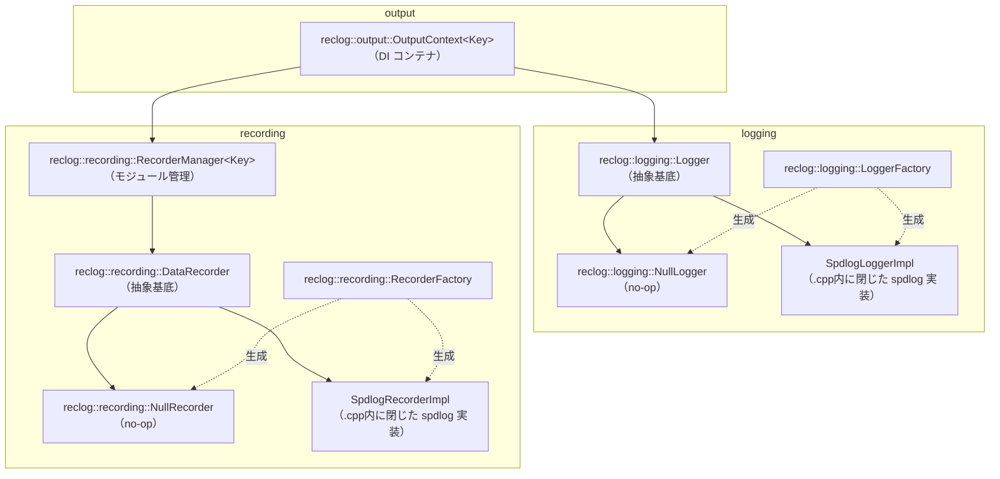

# 出力システム設計ドキュメント

## 概要

科学技術計算シミュレータにおいて、**診断ログ**と**解析データ**を分離しつつ統一的に管理する出力システム。

設計上の目標：

- DI（依存性注入）によりアプリケーションコアを出力実装から分離する
- モジュール単位でデータ出力の有効・無効を切り替える
- 出力先（ファイル・コンソール等）を柔軟に構成できる
- spdlog 等の実装詳細を公開ヘッダーから隠蔽し、ABI・ビルド時間への影響を抑える
- 将来的な並列実行（OpenMP / MPI）対応を考慮する

---

## 全体アーキテクチャ

```text
Application Core
      │
      ▼
reclog::output::OutputContext<Module>（DI）
 ├── reclog::logging::Logger（診断ログ）
 └── reclog::recording::RecorderManager<Module>
        ├── Module::kX → reclog::recording::DataRecorder
        ├── Module::kY → reclog::recording::DataRecorder
        └── Module::kZ → reclog::recording::DataRecorder
```

- 診断ログと解析データは完全に分離する
- 解析データはモジュール単位で独立した DataRecorder を持つ

---

## ファイル構成

- `include/reclog/`
    - `logging/`
        - `log_level.hpp` — `LogLevel` 定義（spdlog 非依存）
        - `logger.hpp` — `Logger` 抽象基底クラス（spdlog 非依存、fmt のみ依存）
        - `null_logger.hpp` — 何もしない実装
        - `logger_factory.hpp` — Logger インスタンス生成ファクトリ（宣言のみ）
    - `recording/`
        - `data_recorder.hpp` — `DataRecorder` 抽象基底クラス・`Write()` ヘルパー
        - `null_recorder.hpp` — 何もしない実装
        - `recorder_manager.hpp` — モジュール別管理（header-only）
        - `recorder_factory.hpp` — DataRecorder インスタンス生成ファクトリ（宣言のみ）
    - `output/`
        - `output_context.hpp` — `Logger` + `RecorderManager` の DI コンテナ（header-only）
- `src/`
    - `logging/logger_factory.cpp` — spdlog を使った Logger 実装（この翻訳単位に閉じる）
    - `recording/recorder_factory.cpp` — spdlog を使った DataRecorder 実装（この翻訳単位に閉じる）

テスト用:

- `tests/support/spy_logger.hpp` — メモリ蓄積によるテスト検証用 Logger 実装

---

## 責務分離

### reclog::logging::Logger（診断ログ）

- デバッグ・進行状況・エラー報告を担う
- ログレベル制御（trace / debug / info / warn / error / critical）
- 非同期対応可能
- 人間向けの可読テキストを出力する

### reclog::recording::DataRecorder（解析データ）

- 科学データをモジュール別に記録する
- Enable / Disable による出力制御（レベル概念なし）
- 出力フォーマットは raw（CSV 等、タイムスタンプ等のメタデータなし）

---

## spdlog 隠蔽方針

`Logger` / `DataRecorder` は純粋仮想インターフェースのみを公開ヘッダーに置き、
spdlog への依存は `src/logging/logger_factory.cpp` / `src/recording/recorder_factory.cpp` の
翻訳単位に閉じ込める。実装クラス（`SpdlogLoggerImpl` / `SpdlogRecorderImpl`）は
これらの `.cpp` 内の無名 namespace で定義され、公開ヘッダーからは一切参照できない。

利点:

- 利用側が spdlog のバージョンやヘッダーを意識しなくてよい
- `reclog_logging` / `reclog_recording` を静的/共有ライブラリとして事前ビルドでき、
  利用側の再コンパイルコストを抑えられる
- spdlog の ABI 変更が公開インターフェースに波及しない

トレードオフ:

- `LoggerFactory` / `RecorderFactory` が返すインスタンスの生成は必ずファクトリ経由になる
  （テストでは `NullLogger` / `NullRecorder` を直接生成すればよい）

---

## インターフェース定義

### reclog::logging::Logger

```cpp
// include/reclog/logging/logger.hpp

namespace reclog::logging {

enum class LogLevel : std::uint8_t { kTrace = 0, kDebug, kInfo, kWarn, kError, kCritical, kOff };

class Logger {
public:
    virtual ~Logger() = default;

    virtual void Log(LogLevel level, std::string_view msg) = 0;
    virtual void SetLevel(LogLevel level) = 0;
    virtual LogLevel Level() const = 0;

    // 非仮想ヘルパー: コスト高い文字列生成をレベル確認後に行うために使う
    bool ShouldLog(LogLevel lvl) const { return lvl >= Level(); }

    // 非仮想テンプレートヘルパー: fmt でフォーマットしてから Log(level, string_view) に委譲する
    template <typename... Args>
    void Log(LogLevel level, fmt::format_string<Args...> fmt_str, Args&&... args);
};

} // namespace reclog::logging
```

`Log()` の仮想オーバーロードとテンプレートオーバーロードは C++ の名前解決上、
派生クラスで `Log(LogLevel, string_view)` を `override` すると同名のテンプレートが
隠蔽される。派生クラス（`NullLogger` / `SpyLogger` / `SpdlogLoggerImpl` 等）では
`using Logger::Log;` を明示することでテンプレートオーバーロードを可視化している。

### reclog::recording::DataRecorder

```cpp
// include/reclog/recording/data_recorder.hpp

namespace reclog::recording {

class DataRecorder {
public:
    virtual ~DataRecorder() = default;

    virtual void Enable() = 0;
    virtual void Disable() = 0;
    virtual bool IsEnabled() const = 0;

    virtual void Output(std::string_view msg) = 0;
    virtual void Flush() = 0;

    // 非仮想ヘルパー: fmt でフォーマットしてから Output() に渡す
    template <typename... Args>
    void Write(fmt::format_string<Args...> fmt_str, Args&&... args);
};

} // namespace reclog::recording
```

#### Write() の設計方針

`Output(string_view)` は文字列を受け取るだけなのでラッパー経由では fmt のフォーマット機能が失われる。
これを解決するため、非仮想テンプレートの `Write()` を提供する。

```cpp
recorder.Write("{},{:.6f}", step, value);
```

- フォーマット文字列は `fmt::format_string` によりコンパイル時にチェックされる
- `IsEnabled()` が false の場合は `fmt::format` 自体をスキップする（フォーマットコスト不要）
- 仮想関数は `Output(string_view)` のみなので、テスト・モックが容易

---

## クラス構成



---

## 各クラスの詳細

### reclog::logging::Logger 実装クラス

| クラス                      | 所在                                       | 用途                      |
| --------------------------- | ------------------------------------------ | ------------------------- |
| `reclog::logging::NullLogger` | `include/reclog/logging/null_logger.hpp`     | 何もしない、DI デフォルト |
| `SpdlogLoggerImpl`          | `src/logging/logger_factory.cpp`（非公開） | spdlog 同期・非同期       |
| `SpyLogger`（tests/）       | `tests/support/spy_logger.hpp`             | メモリ蓄積、テスト検証用  |

### reclog::recording::DataRecorder 実装クラス

| クラス                          | 所在                                           | 用途                                 |
| ------------------------------- | ---------------------------------------------- | ------------------------------------ |
| `reclog::recording::NullRecorder` | `include/reclog/recording/null_recorder.hpp`     | 何もしない、DI デフォルト            |
| `SpdlogRecorderImpl`            | `src/recording/recorder_factory.cpp`（非公開） | spdlog ファイル出力（`%v` パターン） |

`SpdlogRecorderImpl` はコンストラクタ時に `set_pattern("%v")` を設定し、メッセージのみを出力する
（タイムスタンプ等を付加しない）。初期状態は disabled。

### reclog::recording::RecorderManager\<Key\>

enum class をキーにして複数の DataRecorder を管理する。`unique_ptr` で所有する。

```cpp
template <typename Key>
class reclog::recording::RecorderManager {
public:
    void RegisterRecorder(Key key, std::unique_ptr<DataRecorder> recorder);
    DataRecorder& operator[](Key key);            // 未登録は out_of_range
    const DataRecorder& operator[](Key key) const;
    void FlushAll();
};
```

### reclog::output::OutputContext\<Key\>

Logger と RecorderManager を一つにまとめ、アプリケーションコアへ DI で注入する。

```cpp
template <typename Key>
class reclog::output::OutputContext {
public:
    OutputContext(logging::Logger& logger, recording::RecorderManager<Key>& recorders);
    logging::Logger& GetLogger();
    recording::RecorderManager<Key>& GetRecorders();
};
```

---

## ターゲット構成

`reclog` は 3 つの CMake ターゲットに分割されている。

| ターゲット        | 種別           | 内容                                                            |
| ----------------- | -------------- | --------------------------------------------------------------- |
| `reclog::logging`   | 通常ライブラリ | `Logger` インターフェース + spdlog 実装（`.cpp` に閉じる）      |
| `reclog::recording` | 通常ライブラリ | `DataRecorder` インターフェース + spdlog 実装（同上）           |
| `reclog::output`    | INTERFACE      | `OutputContext<Key>`（header-only）。logging/recording を束ねる |

fmt は `Write()` / `Log()` テンプレートヘルパーが公開ヘッダーで型を使うため PUBLIC 依存、
spdlog は実装（`.cpp`）にのみ現れるため PRIVATE 依存とする。

---

## install / find_package(reclog CONFIG) 対応

`-DRECLOG_INSTALL=ON` を指定した場合のみ `install(EXPORT)` を評価する（デフォルト OFF）。
FetchContent/add_subdirectory 経由の利用ではこのブロックは評価されないため影響を受けない。

`reclog_logging` / `reclog_recording` の PRIVATE 依存である spdlog（静的ライブラリ）は、
CMake の仕様上 `install(EXPORT)` の export セットに含まれていないとエラーになる
（静的リンクの推移依存はリンク時に解決される必要があるため）。この問題は依存の取得経路で
対応が異なる。

- **FetchContent で新規取得した場合**: `cmake/dependencies-lib.cmake` が
  `RECLOG_FMT_FETCHED` / `RECLOG_SPDLOG_FETCHED` を `ON` に設定する。この場合、
  トップレベル `CMakeLists.txt` の install ブロックで `fmt` / `spdlog` 自体も
  `reclogTargets` の export セットに含める（`reclog::spdlog` 等の名前で同梱される）。
  `reclogConfig.cmake.in` 側もこのフラグを見て `find_dependency(fmt/spdlog)` を
  スキップする（同梱物と二重に解決させない）。
- **find_package で既存の物を見つけた場合**: 利用側の環境に既にインストールされているため
  export セットに含めず、`reclogConfig.cmake.in` の `find_dependency()` で再解決する。

spdlog は内部で `Threads::Threads` にリンクしているため、FetchContent 経由の場合は
`reclogConfig.cmake.in` で `find_dependency(Threads)` も解決しておく必要がある。

各ターゲットの実体名（`reclog_logging` 等）と `ALIAS` 名（`reclog::logging` 等）が異なるため、
`install(EXPORT ... NAMESPACE reclog::)` がそのままでは `reclog::reclog_logging` という
意図しない名前になる。`EXPORT_NAME` プロパティ（`set_target_properties(reclog_logging
PROPERTIES EXPORT_NAME logging)` 等）で export 時の名前を `logging` に合わせている。

---

## ファクトリ

ファクトリは spdlog の初期化手順を呼び出し側から隠蔽する。

### reclog::logging::LoggerFactory

```cpp
// ファイルへ書き込む同期ロガー
auto logger = reclog::logging::LoggerFactory::MakeFile("app", "app.log", reclog::logging::LogLevel::kInfo);

// 標準出力（カラー付き）
auto logger = reclog::logging::LoggerFactory::MakeConsole("app", reclog::logging::LogLevel::kDebug);

// 何も出力しない
auto logger = reclog::logging::LoggerFactory::MakeNull();
```

### reclog::recording::RecorderFactory

```cpp
// ファイルへ書き込む同期レコーダー（初期状態は disabled）
auto rec = reclog::recording::RecorderFactory::MakeFile("moduleX", "moduleX.csv");
rec->Enable();

// CSV ファイル（ヘッダ行を自動出力）
auto csv = reclog::recording::RecorderFactory::MakeCsvFile("results", "results.csv", "step,value");

// JSON Lines (NDJSON) ファイル（1行1文字列。JSON構築は呼び出し側の責務）
auto jl = reclog::recording::RecorderFactory::MakeJsonLinesFile("results", "results.jsonl");

// 何も出力しない
auto rec = reclog::recording::RecorderFactory::MakeNull();
```

---

## fmt と spdlog の依存関係

spdlog はデフォルトで fmt をバンドルするが、`SPDLOG_FMT_EXTERNAL=ON` を設定することで
プロジェクトが別途導入した `fmt::fmt` を共有できる。

```cmake
# cmake/dependencies-lib.cmake
set(SPDLOG_FMT_EXTERNAL ON CACHE BOOL "" FORCE)
FetchContent_MakeAvailable(spdlog)
```

これにより：

- バイナリ内に fmt は1インスタンスだけになる（ODR 違反なし）
- `data_recorder.hpp` の `#include <fmt/format.h>` と spdlog が同じ fmt ライブラリを参照する

依存解決は `find_package` を優先し、見つからない場合のみ `FetchContent` にフォールバックする
（`cmake/dependencies-lib.cmake` 参照）。呼び出し側が先に `fmt::fmt` / `spdlog::spdlog` ターゲットを
用意している場合はそちらが優先される。

---

## 初期化例

```cpp
#include "reclog/logging/logger_factory.hpp"
#include "reclog/output/output_context.hpp"
#include "reclog/recording/recorder_factory.hpp"
#include "reclog/recording/recorder_manager.hpp"

enum class Module : std::uint8_t { kX, kY, kZ };

// 診断ロガー
auto logger = reclog::logging::LoggerFactory::MakeFile("diag", "diag.log", reclog::logging::LogLevel::kInfo);

// モジュール別レコーダー
reclog::recording::RecorderManager<Module> manager;
manager.RegisterRecorder(Module::kX, reclog::recording::RecorderFactory::MakeFile("moduleX", "moduleX.csv"));
manager.RegisterRecorder(Module::kY, reclog::recording::RecorderFactory::MakeNull());

// OutputContext に統合して注入
reclog::output::OutputContext<Module> out(*logger, manager);
run(out);
```

---

## 使用例

```cpp
void run(reclog::output::OutputContext<Module>& out) {
    out.GetLogger().Log(reclog::logging::LogLevel::kDebug, "initialize start");

    out.GetRecorders()[Module::kX].Enable();
    out.GetRecorders()[Module::kY].Disable();

    for (int step = 0; step < 100; ++step) {
        double value = compute(step);

        // fmt::format_string によるコンパイル時チェック付きフォーマット
        out.GetRecorders()[Module::kX].Write("{},{:.6f}", step, value);
    }

    out.GetRecorders()[Module::kX].Flush();
}
```

---

## 非同期運用方針

| 用途       | 推奨                                 |
| ---------- | ------------------------------------ |
| 診断ログ   | 非同期推奨（SpdlogLoggerImpl async） |
| 解析データ | 原則同期（順序保証・データ欠落防止） |

大量出力時のみ解析データの非同期化を検討する。

---

## 将来拡張

- `BufferedRecorder` — バッファリングして一括書き出し
- `BinaryRecorder` — バイナリ形式（HDF5 等）への出力
- `MPIRecorder` — MPI ランク別のファイル振り分け
- 設定ファイル駆動での初期化
